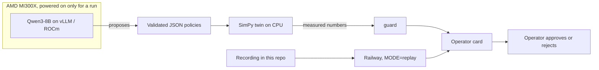

# TwinVerdict

AI proposes. The simulator verifies. The operator decides.

[](https://github.com/focampok/twinverdict/actions/workflows/ci.yml)
[](LICENSE)

[Live app](https://twinverdict.focampo.com) · [Live run](https://twinverdict.focampo.com/live) · [Pitch](https://info-twinverdict.focampo.com) · Demo video: `TODO_VIDEO_URL`

A simulated production line: 5 machines, 3 products. An open model proposes maintenance and dispatch policies as validated JSON. The simulator scores every policy on many seeds. The number on the card comes from the simulator. A person approves or rejects it.

## Problem

A plant manager and a maintenance engineer already know the failure modes. What they do not have is a dispatch and maintenance policy they can defend with a measured result. A fixed rule (earliest due date, one preventive stop per shift) delivers about half of orders on time. Changing the rule by hand does not show whether the change holds on days the search never saw.

## Solution

Three steps, and the model never gets the last word.

1. **Propose.** Qwen3-8B, served by vLLM, returns a maintenance and dispatch policy as JSON. Pydantic accepts or rejects it before any simulation.
2. **Verify.** A SimPy twin runs the policy on many seeds, including a holdout the search did not train on. The objective, the confidence interval, and the on-time rate are simulator outputs.
3. **Decide.** The operator card states what to do and how much it changes. `guard/numbers.py` checks every figure in the text against `operator_card["numbers"]`. The operator approves or rejects.



The public app on Railway reads the recording. It does not call the model or the simulator.

## Results

**On time, holdout: 50.6% → 98.9%.**

Official run: job `c0c92625-de22-4520-accb-6a17c1a76428`, real vLLM (Qwen3-8B on an AMD Instinct MI300X). Holdout is 300 seeds the search did not use. The feedback loop’s holdout objective is **1.3691 [1.3530, 1.3842]**. The search spent **37,560** simulations. Source: [`bench/results/efficiency_20261017.json`](bench/results/efficiency_20261017.json). Full tables and the earlier sessions are in [`docs/BENCHMARKS.md`](docs/BENCHMARKS.md).

| Method | Train | Holdout | 95% CI | On time | Simulations | Sims to 90% of the gap |
|---|---:|---:|---|---:|---:|---|
| Fixed rule | 0.7858 | 0.7725 | [0.7431, 0.8017] | 50.6% | 180 | does not reach |
| Optuna TPE | 1.5188 | 1.5126 | [1.5048, 1.5198] | 99.9% | 69,300 | 5,760 |
| LLM, no feedback | 1.2318 | 1.2259 | [1.2167, 1.2349] | 91.4% | 69,300 | does not reach |
| Feedback loop | 1.3755 | 1.3691 | [1.3530, 1.3842] | 98.9% | 37,560 | does not reach |

Higher objective is better. The 95% interval is a bootstrap of 2,000 resamples (`PCG64(0)`). “Sims to 90% of the gap” is the first point at or above `0.7858 + 0.9 × (1.5188 − 0.7858) = 1.4455`.

Optuna TPE is ahead on this plant. Its holdout objective is 1.5126 and its on-time rate is 99.9%. It crosses 90% of the gap from the fixed rule after 5,760 simulations. The feedback loop stays under that threshold, and its on-time rate of 98.9% is below Optuna’s 99.9%. The loop’s result is a policy a person can read: critical-ratio dispatch (weights setup 0.2, due date 0.5, wear risk 0.3), at most one preventive stop per shift, and five conditions. Every figure on the card was measured. The loop also used fewer simulations (37,560, from 201 valid proposals) than the 69,300 used by Optuna and by the one-shot LLM.

Under stress (+30% failures, demand ×1.5) both policies get worse. On time goes from 13.0% to 26.4%. The larger gap there is throughput (748 to 950 completed orders). The card does not promise the same on-time jump on a stressed day.

## Built on AMD

Inference runs on an **AMD Instinct MI300X** (virtual function reported by ROCm). vLLM serves `Qwen/Qwen3-8B` inside the ROCm container. The GPU is not on the public internet. The laptop reaches it through an SSH tunnel to `127.0.0.1`.

Simulation runs on **CPU**. In the official run the worker used the laptop’s cores. The MI300X did not execute SimPy.

The recording is [`data/replay/live_c0c92625-de22-4520-accb-6a17c1a76428.json`](data/replay/live_c0c92625-de22-4520-accb-6a17c1a76428.json). `fake` is `false`. It has 290 samples over 742 seconds (2-second interval), model `Qwen/Qwen3-8B`, GPU name `AMD Instinct MI300X VF`.

| | |
|---|---|
| VRAM | 93% on every sample |
| GPU use | peak 100%, mean 27% |
| Power | peak 570 W, mean 249 W |
| Tokens counted by vLLM | 22,003 → 309,085 |
| Tokens per second | peak 2,130, mean 1,257 where a rate was reported |
| Proposals | 201 valid, 0 invalid, 483 duplicates |
| Simulations | 37,560 |
| Best training objective | 1.3755 |

The public demo runs in **replay**. The GPU is powered on only for a run and then destroyed. Railway serves the files already in this repository: the live recording, [`bench/results/operator_card_c0c92625-de22-4520-accb-6a17c1a76428.json`](bench/results/operator_card_c0c92625-de22-4520-accb-6a17c1a76428.json), and the matching replay JSON. The same guard that runs in tests checks the card text against those numbers.

## Quickstart

Python 3.12, [uv](https://docs.astral.sh/uv/), and Postgres 16 (the same major version as CI and the Railway Postgres service). Docker is not required.

Once, if the role does not exist yet:

```bash
sudo -u postgres psql -c "CREATE ROLE planta LOGIN PASSWORD 'planta' CREATEDB;"
```

Then, from a clean clone:

```bash
cp .env.example .env
make setup
make db
make web
```

`.env.example` sets `MODE=replay` and `REPLAY_JOB_ID=c0c92625-de22-4520-accb-6a17c1a76428`. Open http://localhost:8000/ for the operator card and http://localhost:8000/live for the recorded run. No GPU and no model process are required. The card and the curve come from the JSON files in the repo. `POST /jobs` returns 503 `{"error":"replay_only"}`.

```bash
make test
make lint
```

## Run with a real GPU

The instance address and the vLLM API key belong to that session. They are not in the repo. Set them in the shell. `infra/gpu/gpu.sh` defaults `GPU_IP` only as a convenience for one session; override it.

```bash
export GPU_IP=<instance address>
export LLM_API_KEY=<vLLM key for this session>
infra/gpu/gpu.sh serve Qwen/Qwen3-8B
infra/gpu/gpu.sh wait
infra/gpu/gpu.sh tunnel
make gpu2 MODE=live
```

`serve` starts vLLM inside the ROCm container. `wait` blocks until `/v1/models` returns 200 (at most 15 minutes). `tunnel` forwards local port 8000 to the instance, so vLLM stays on localhost. `make gpu2` refuses to start unless that endpoint answers, and it refuses to start while the mock server is still running. It enqueues the search, drains the worker on the laptop CPU (`SIM_WORKERS` defaults to 16), runs the no-feedback LLM baseline, freezes the replay, and writes the four-method table. `MODE=live` is what makes the web app call the model; the search itself uses `LLM_BASE_URL` (default `http://127.0.0.1:8000/v1`).

## Deploy on Railway

The image is `Dockerfile`. `railway.toml` sets the health check to `/healthz` (timeout 60 seconds) and starts with `alembic upgrade head` and uvicorn. There is no `docker-compose.yml`.

On the web service:

| Variable | Value |
|---|---|
| `DATABASE_URL` | `${{Postgres.DATABASE_URL}}` |
| `MODE` | `replay` |
| `REPLAY_JOB_ID` | `c0c92625-de22-4520-accb-6a17c1a76428` |

`DATABASE_URL` may use Railway’s `postgresql://` scheme. The app rewrites it to `postgresql+psycopg` and keeps `sslmode`. `LLM_BASE_URL`, `LLM_MODEL`, and `LLM_API_KEY` are unused while `MODE=replay`. Leave `ADMIN_TOKEN` empty unless you set one. After deploy, `GET /healthz` returns `{"status":"ok"}`.

## Limitations

This is a simulated plant, partly shaped with the public AI4I 2020 dataset. It is not a deployment in a factory. The composite objective is this project’s weighted score, and Optuna scores higher on it. The on-time jump shrinks under the stress scenario. The public site cannot start a new search. Policies are validated JSON, never generated code. There is no user login, no multi-plant tenancy, and no fine-tuning.

## Roadmap

Run another live search when a GPU session is up, and keep publishing the recording so the demo survives after the instance is destroyed. Narrow the gap to Optuna while keeping the policy readable. If a plant shares its own history, refit the wear curve to that history and say what was assumed.

## License

[MIT](LICENSE). The code in this repository was written during the hackathon, starting Monday 12 October 2026, after kickoff.
